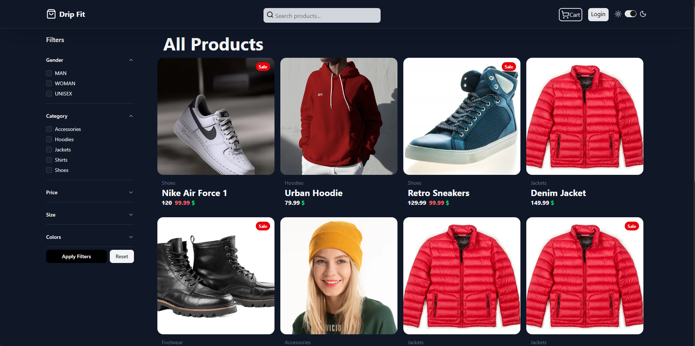
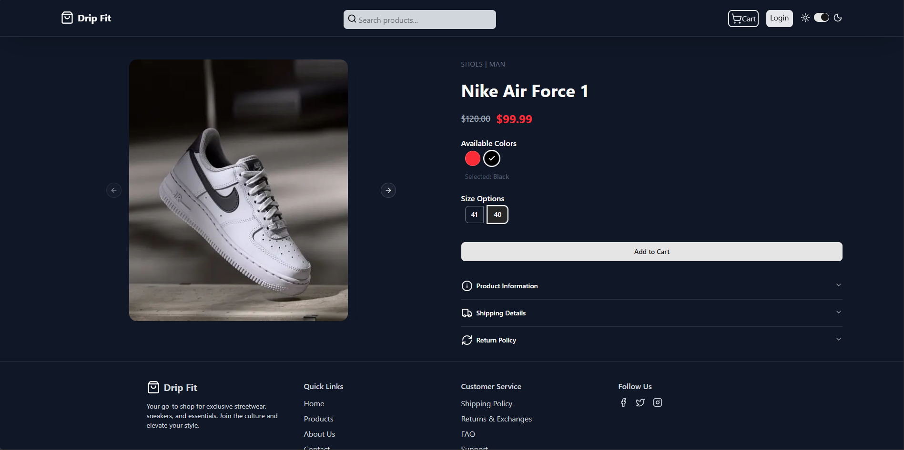
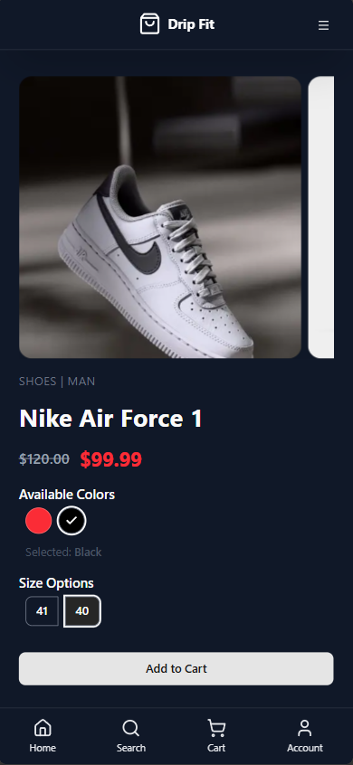

<div align="center">

# Drip Fit

**A full-stack streetwear store with a built-in admin dashboard.**

[**Live demo**](https://dripfit-shop.vercel.app)


</div>

## About

Drip Fit is an online clothing and sneaker shop I built end to end: a storefront where customers browse, filter and order, and a private dashboard where the owner manages products and orders.

## Features

**For shoppers**
- Search with live suggestions, plus filters for gender, category, price, size and colour
- Product pages with colour and size variants, sale prices and stock-aware add to cart
- Persistent cart, checkout, and an order confirmation email
- Google sign-in, an order history with a progress tracker, and order cancellation
- Dark and light themes, responsive from phone to desktop

**For the store owner**
- Dashboard with revenue, a 14-day sales chart, order pipeline and low-stock alerts
- Add, edit and delete products with variants and image uploads
- Order management with status updates that keep stock accurate

## Screenshots

<table>
  <tr>
    <td width="42%"></td>
    <td width="42%"></td>
    <td width="16%"></td>
  </tr>
  <tr>
    <td align="center"><sub>Catalogue</sub></td>
    <td align="center"><sub>Product page</sub></td>
    <td align="center"><sub>Mobile</sub></td>
  </tr>
</table>

## Built with

- **Frontend:** Next.js (App Router), React, TypeScript, Tailwind CSS, shadcn/ui
- **Data and state:** PostgreSQL with Prisma, TanStack Query, Zustand
- **Forms and validation:** React Hook Form, Zod
- **Auth:** NextAuth.js with Google
- **Services:** Cloudinary for images, Nodemailer and React Email for receipts
- **Hosting:** Vercel

## Run it locally

```bash
git clone https://github.com/AhmedAyman911/drip-fit.git
cd drip-fit
npm install
cp .env.example .env      # then fill in your own keys
npx prisma migrate deploy
npm run dev
```

## Author

Built by [Ahmed Ayman](https://github.com/AhmedAyman911).
